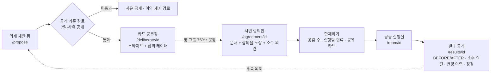

# 시민권력 OS (가칭) — 통합 설계서 (프로토타입 v3)

> 두 설계를 합친 버전입니다. 하나는 우리 쪽 설계(`design_spec.md`와 TVING 스타일 `prototype_v2`)이고, 다른 하나는 친구의 Next.js 시민 DAO 설계서입니다. 모든 데이터는 예시입니다. 후보 지지·모금·토큰 기능은 없습니다. 수치는 여론을 대표하지 않습니다.

## 1. 무엇을 어디서 가져왔나

| 영역 | 가져온 쪽 | 이유 |
|---|---|---|
| 제품 정체성(문제 제안 → 공동 실행 → 결과 검증), 상태 전이, 거버넌스 원칙 10개 | 우리 설계 | 정당·선거·토큰 플랫폼으로 오해받지 않는 시민 문제 해결 인프라가 핵심이라서 |
| TVING식 히어로 캐러셀, 가로 카드 줄, 해결된 이야기(BEFORE/AFTER), 활동 배지(의결권·금전 가치 없음) | 우리 v2 | 처음 온 시민이 "참여하고 싶다"고 느끼는 시각적 몰입감 |
| 의제 상세 7개 섹션, 제안 폼(접수 ≠ 채택), 공동 실행실, 결과 공개(한계·소수 의견·변경 이력·정정 경로) | 우리 설계 | 실행과 검증, 정정 가능성. 신뢰의 근거가 되는 부분 |
| Polis식 카드 공론장(스와이프, 찬성·반대·건너뛰기, 댓글 없음, 140자 새 문장) | 친구 설계 | 댓글 싸움 없이 1분 안에 참여할 수 있고 공통분모를 찾는 데 강함 |
| 합의 레이더(두 그룹 산점도, 양 그룹 75%↑ → 합의안 초안) | 친구 설계 | "다수결"이 아니라 "서로 다른 사람들의 공통 합의"를 보여줌 |
| 공식 문서 양식 뷰어와 합의율 도장, 임팩트 카운트업, 공유 카드 | 친구 설계 | 무게감과 확산력 |
| Next.js App Router + TS + Tailwind, 컴포넌트 구조 | 친구 설계 (우리 기술 권고와도 일치) | |

**바꾸거나 뺀 것 (친구 설계에서)**
- "의결·입법 요구안·서명"은 **"시민 합의안"**으로 바꿨습니다. 법적 효력이 있는 절차처럼 보이지 않게 하기 위해서입니다.
- Privy 지갑, Snapshot EIP-712, IPFS 영구 서명, PASS 실명 확인은 **삭제했습니다**. 대신 **함께하기**(공감 + 실행팀 합류)를 넣었습니다. 숫자만 공개하고 언제든 철회할 수 있습니다.
- 실명·지역 서명자 실시간 명부는 **삭제했습니다**. 정치 성향이 노출될 위험이 있기 때문입니다.
- 공유 카드는 "나는 ○○ 합의안 실행팀의 N번째 참여자입니다"로 바꿨습니다.

## 2. 통합 흐름

## 3. 화면 (라우트)
| 라우트 | 내용 |
|---|---|
| `/` | 풀스크린 히어로(AI 상징 이미지 · 시민권력 · 위임한 힘을, 다시 시민에게) · 3개 행동 버튼 · 임팩트 카운트업 · 단계별 의제 수 · 참여할 의제 / 우리 동네 가로 줄 · 해결된 이야기 · 시민권력이란 배너 |
| `/issues` | 의제 탐색(분야 필터, 단계·필요 역할·업데이트 날짜, "참여 수는 순위 아님") |
| `/issues/[id]` | 단계 표시줄 + 7개 섹션(문제/영향/사실·모름/제안·반대/다음 결정/역할/변경 이력·출처·정정) |
| `/propose` | 제안 폼 → 접수 화면 + 공개 기준 5가지 안내 |
| `/deliberate/[id]` | 카드 스와이퍼(N/20) · 새 문장 제안 모달 · 합의 레이더 · 합의안 초안 자동 표시 |
| `/agreement/[id]` | 시민 합의안 문서(법적 효력 없음 고지, 합의율 도장, 소수 의견) + 함께하기 패널 + 공유 카드 모달 |
| `/room/[id]` | 목표·역할·작업 체크리스트·회의/결정(소수 의견)·자원(현금 0원)·이해충돌·출처·다음 행동 |
| `/results/[id]` | BEFORE/AFTER · 지표와 한계 · 소수 의견 · 기관 답변·후속 · 미완료 사유 · 변경 이력 · 정정 요청 |

로그인은 카카오 버튼 모양의 **모의 소셜 로그인**(localStorage에 별칭 저장)입니다. 실제 인증, 지갑, 서명은 없습니다.

## 4. 데이터 모델 스케치 (PostgreSQL 기준, 개인정보 분리)
- `users`(공개 별칭, 역할) / `user_private`(연락처·인증 결과, 비공개 분리 저장)
- `issues`(제목, 설명, 지역, 분야, **stage**, 제안자, 공개 범위) · `issue_reviews`(기준별 판정, 사유, 검토자)
- `evidence`(출처, 확인 상태)
- `statements`(issue_id, 본문 ≤140, 작성자, 검토 상태) · `statement_votes`(user_id, statement_id, agree/disagree/pass, **비공개**) · `opinion_groups`(클러스터링 결과, 그룹별 찬성률 집계만 공개)
- `agreements`(issue_id, 버전, 본문, 합의 기준·참여 수 스냅샷, 소수 의견)
- `supports`(user_id, agreement_id, 생성·철회 시각, **집계 수만 공개**)
- `teams` / `memberships`(역할, 기간, 철회) / `tasks` / `decisions`(결정 방식, 근거, 소수 의견)
- `partners`(협력 유형, 공식/협의 중 구분, 이해관계) · `resources`(현물 포함, 현금 0 원칙)
- `outcomes`(before/after 지표, 한계) · `institution_responses`
- `audit_events`(상태 변경·숨김·정정의 주체·시각·사유) · `reports`(신고·정정 요청 처리)

## 5. 법적·운영 가드레일
1. **명칭**: "의결·입법·서명·청원·투표"라는 말을 쓰지 않고 "시민 합의안·함께하기·공감"을 씁니다. 합의안 문서에는 법적 효력이 없다고 고지합니다.
2. **공식 제도와의 관계**: 주민조례발안법(주민조례청구)과 청원법(국민동의청원 등)은 별도의 법정 절차입니다. 실제 청구는 공식 시스템(예: 주민e직접)으로 안내하고, 대신 접수하거나 대리 서명을 모으지 않습니다. *(법률 검토 필요)*
3. **개인정보**: 지지자·참여자 명단(실명·지역)은 공개하지 않고 집계 숫자만 공개합니다. 카드 응답은 개인별로 공개하지 않습니다. 정치적 견해는 민감정보일 수 있으므로 최소 수집과 별도 동의, 보관 기간, 철회와 삭제를 보장합니다. 블록체인 같은 영구 저장은 쓰지 않습니다.
4. **선거법**: 후보·정당 지지와 반대, 모금, 선거기간 중 선거 관련 서명운동 기능이 없습니다. 선거기간에는 의제 운영 지침을 별도로 둡니다. *(법률 검토 필요)*
5. **대표성**: 참여 수와 합의율은 참고 정보입니다. 여론이나 법적 투표로 표현하지 않습니다.
6. **금전·토큰**: 배지는 활동 기록일 뿐 의결권이나 금전 가치가 없습니다. 토큰과 기부 결제는 없습니다.
7. **기관 표현**: 협의 중인 기관을 공식 협력기관처럼 표시하지 않습니다.
8. **정정과 이의 제기**: 모든 상태 변경과 숨김에 사유를 기록하고, 정정 요청 경로를 공개합니다.

## 6. 미결정 사항 (앨런님 결정 필요)
- 정식 이름 ("시민권력 OS"는 가칭)과 첫 파일럿 의제 (관리비 공개 vs 통학로 안전 등)
- 카드 공론장을 모든 의제에 쓸지, 쟁점이 있는 의제에만 쓸지
- 합의 기준 (양 그룹 75%? 최소 참여 수?)과 클러스터링 방식 (Polis 자체 호스팅 vs 간이 집계)
- 로그인 방식 (카카오 OAuth / 이메일)과 1인 1계정 보장 수준 (본인확인 도입 여부와 비용, 개인정보 부담)
- 공개 기준 검토 주체 (운영진 / 시민 검토단 / 혼합)와 이의 제기 처리 기한
- 공식 청원·주민조례청구로 연결해 주는 "다음 단계 안내"를 넣을지 여부 (법률 검토 후)
- 공유 카드에 들어갈 문구와 개인 식별 정보 범위

## 7. v3.1 추가 (완성본 프로토타입)
- 추가 화면: `/about`(시민권력이란 · 선언문), `/principles`(원칙 10 · 공개 기준 · 합의안 기준 · 개인정보 · 정정), `/me`(내 참여 · localStorage), 404
- 내비게이션: 모바일은 하단 탭(홈 · 의제 · 제안 · 시민권력 · 내 참여), 데스크톱은 상단 헤더(+ 운영 원칙)
- 모든 의제·단계 라우트를 데이터로 생성합니다. 도달하지 않은 단계는 잠금 안내를 보여줍니다.
- 정적 내보내기(`out/`), SEO 메타데이터, OG 이미지(`/og.jpg`), 파비콘, 로딩 상태, 명도 대비 개선
